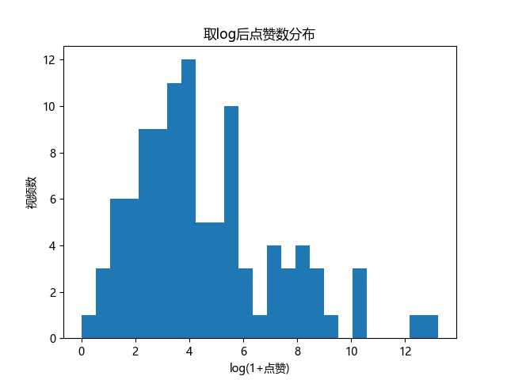
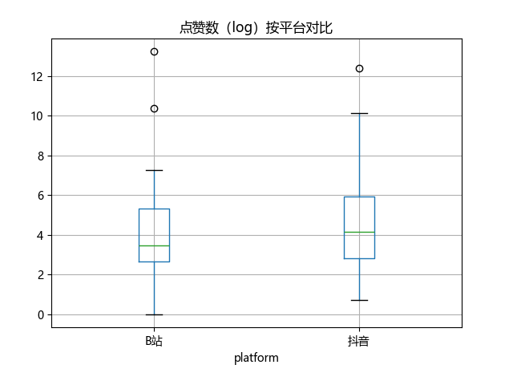
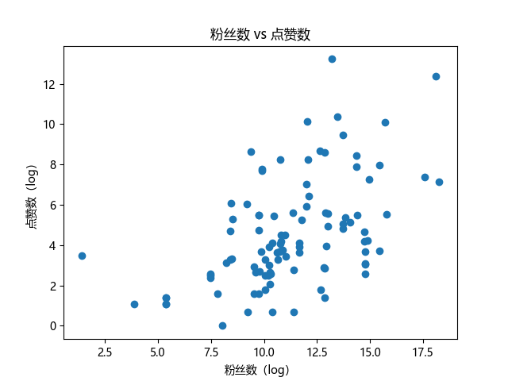
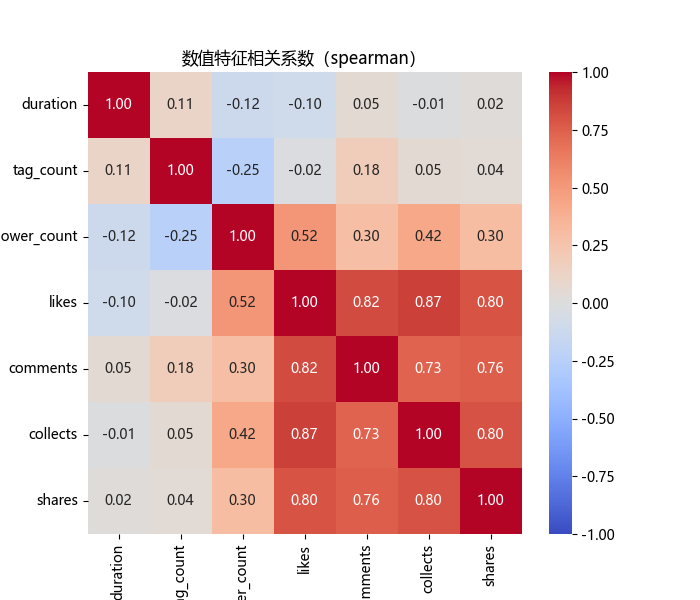

# 非遗短视频数据分析（101 条）

这是我对 101 条非遗短视频做的探索性分析，想搞清楚什么决定了一条视频的传播效果。
账号主体类型仍在核对，所以本版只讨论视频形式与账号规模。

## 数据

- 来源：手工从抖音、B站采集公开视频（抖音 76 条 / B站 25 条），字段靠人工观看逐条标注
- 规模：101 条视频，21 个字段，分三类：时间与形式、内容特征、互动结果
- 账号主体类型（政务/企业/个人）正在按平台认证信息逐条核对，尚未纳入本版分析
- 原始数据含视频链接与账号名称，未公开；仓库提供的是去除链接后的 `data_t.csv`，可直接运行全部脚本

## 我做了什么

1. 清洗与体检 —— 发现并处理了表格两层表头带来的假数据行和 26 个空列
2. 分布分析 —— 点赞数长尾极端，必须取 log 才看得清
3. 平台对比 —— 箱线图 + 中位数
4. 相关性分析 —— 散点图、Spearman 系数、热力图

## 主要发现

### 1. 点赞数是极端长尾分布

101 条视频的点赞中位数只有几十，但最高的接近 55 万。不取对数的话，直方图上只有一根柱子和一串贴地的点，看不出任何结构。取 `log1p` 之后才恢复成正常的分布形状。



### 2. 抖音的点赞中位数是 B 站的两倍

| 平台 | 条数 | 点赞中位数 |
|---|---|---|
| 抖音 | 76 | 63 |
| B站 | 25 | 31 |

但 B 站的"爆款密度"更高：25 条里有 2 条突破 10 万赞，抖音 76 条里只有 1 条。



### 3. 粉丝数是最相关的因素，但只能解释约 27%

粉丝数与点赞数的 Spearman 相关系数为 **0.52**（中等正相关）。相关系数平方约 0.27，意味着粉丝规模能解释的点赞差异只有四分之一多——剩下近四分之三由其他因素决定。



### 4. 粉丝越多，单位粉丝的点赞效率越低

按粉丝量分成三档，每档的点赞中位数和"每粉丝贡献的点赞"：

| 粉丝档 | 点赞中位数 | 每粉丝贡献 |
|---|---|---|
| 小号 | 2.5 | 1.4% |
| 中号 | 39 | 0.15% |
| 大号 | 192.5 | 0.013% |

点赞总数从 2.5 涨到 192.5（77 倍），但单位粉丝的效率掉了约 100 倍。粉丝数买到的是曝光规模，不是互动浓度。

### 5. 内容特征几乎不提供信息

时长、标签数等采集的内容特征与点赞的相关性都在 ±0.1 以内，热力图上一片浅色。这说明当前采集的字段还不足以解释传播效果。



## 局限

- 样本仅 101 条，统计功效有限
- 抖音不提供播放量，跨平台比较失真
- 内容特征与互动指标几乎无关，说明还有未收集的变量在起作用
- 账号主体类型尚未核对完成，本版无法回答"政务账号与个人账号传播效果有何差异"

## 如何运行

```bash
ip install -r requirements.txt
python 01_hist.py      # 点赞分布与 log 对比
python 02_check.py     # 数据体检、平台对比
python 03_scatter.py   # 粉丝数 vs 点赞、效率分档
python 04_heatmap.py   # 相关性热力图
undefined
