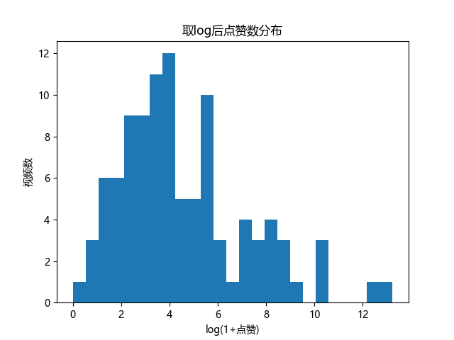
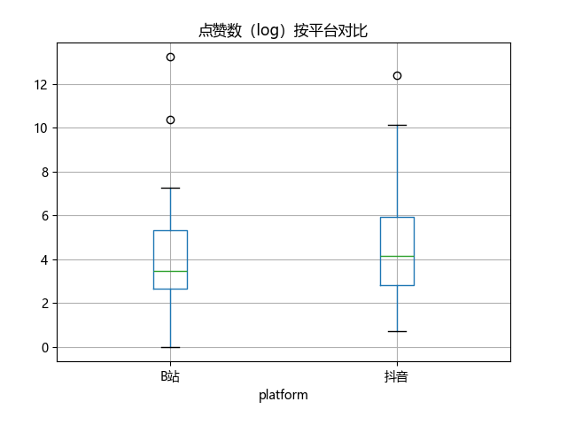
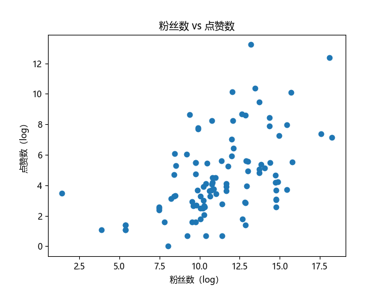
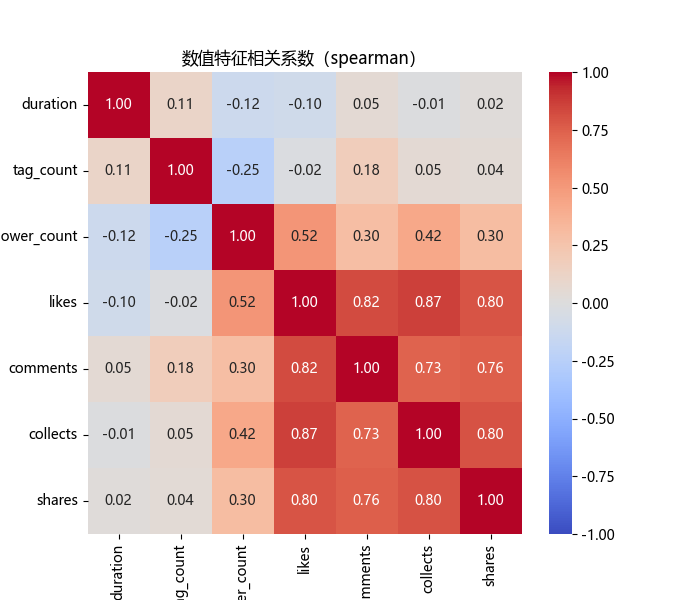

# 非遗短视频数据分析

课程作业，拿 101 条非遗短视频练手，想知道到底什么在影响传播效果。数据都是手工从抖音和 B 站采集的公开视频，抖音 76 条，B 站 25 条，19 个字段，一条条看视频填的。账号主体类型（政务/企业/个人）还要对着平台认证信息核对，这一版先不碰。

原始表里有视频链接和账号名，不太方便公开，仓库里是脱敏后的 `data_t.csv`，下面的分析脚本都能直接跑。`transpose_raw.py` 和 `clean_data.py` 依赖原始表，只能在本地用。

## 做了些什么

1. 清洗。原表是两层表头，转置以后多出一批假行，还有 26 个空列，一并清掉。
2. 看点赞分布。长尾太夸张，不取 log 基本看不出形状。
3. 平台对比。箱线图加中位数。
4. 相关性。散点图、Spearman、热力图。

## 结果

**1. 点赞数是极端长尾**

中位数只有几十，最高的一条接近 55 万。不处理的话直方图上就一根柱子，剩下全贴着地，取 `log1p` 之后才像个正常分布。



**2. 抖音中位数是 B 站的两倍，但 B 站爆款更密**

| 平台 | 条数 | 点赞中位数 |
|---|---|---|
| 抖音 | 76 | 63 |
| B站 | 25 | 31 |

B 站 25 条里有 2 条过了 10 万赞，抖音 76 条只有 1 条。



**3. 粉丝数相关性最强，但也只能解释 27% 左右**

粉丝数和点赞数的 Spearman 系数是 0.52，中等正相关。平方下来约 0.27，剩下四分之三还得看别的因素。



**4. 粉丝越多，单个粉丝贡献的点赞越少**

按粉丝量分三档：

| 粉丝档 | 点赞中位数 | 每粉丝贡献 |
|---|---|---|
| 小号 | 2.5 | 1.4% |
| 中号 | 39 | 0.15% |
| 大号 | 192.5 | 0.013% |

点赞中位数从 2.5 涨到 192.5，差了 77 倍，单位粉丝的效率却掉了大约 100 倍。粉丝数带来的主要是曝光，不是互动。

**5. 采集的内容字段基本没用**

时长、标签数这些和点赞的相关性都在 ±0.1 以内，热力图上一片浅色。说明现在的字段还解释不了传播效果。



## 存在的问题

- 样本只有 101 条，统计上不太站得住
- 抖音拿不到播放量，跨平台比较本来就失真
- 内容特征和互动几乎无关，应该有没采集到的变量
- 账号主体类型还没核完，"政务号和个人号谁传播得更好"这个问题这版回答不了

## 怎么跑

```bash
pip install -r requirements.txt
python 01_hist.py      # 点赞分布与 log 对比
python 02_check.py     # 数据体检、平台对比
python 03_scatter.py   # 粉丝数 vs 点赞、效率分档
python 04_heatmap.py   # 相关性热力图
```
